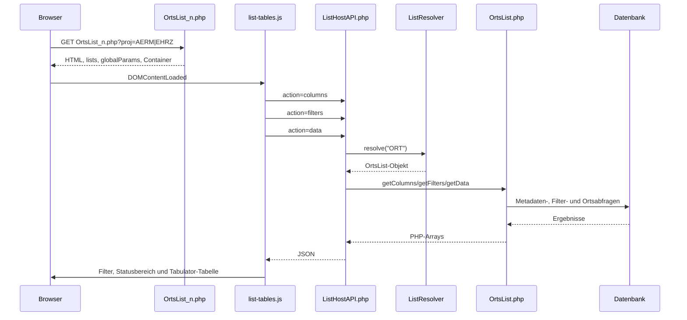

# Verwendung von Tabulator.js am Beispiel `OrtsList_n.php`

## 1. Zweck und Geltungsbereich

Dieses Dokument beschreibt den derzeit implementierten Ablauf der neuen, API-basierten Ortsliste für PSA:

- Einstiegsseite: `FWHist/login/Modules/Psa/OrtsList_n.php`
- Tabulator-Steuerscript: `FWHist/js/list-tables.js`
- Tabulator-JavaScript: `FWHist/js/tabulator-6.3.1/tabulator.min.js`
- Tabulator-CSS: `FWHist/css/tabulator-6.5.2/tabulator.min.css`
- API-Fassade: `FWHist/login/Services/API/ListHostAPI.php`
- Listenimplementierung: `FWHist/login/Modules/Psa/Lists/OrtsList.php`

Die Seite verwendet Tabulator nicht als serverseitig gerenderte HTML-Tabelle. PHP liefert den HTML-Rahmen und eine JavaScript-Konfiguration. Spalten, Filterdefinitionen und Daten werden anschließend per drei separaten HTTP-Anfragen geladen. Tabulator erzeugt daraus die sichtbare Tabelle im Browser.

## 2. Gesamtarchitektur



## 3. Stufe 1: Aufruf und PHP-Bootstrap

### 3.1 Erwartete URL

Die Seite erwartet den Projektparameter:

```text
/FWHist/login/Modules/Psa/OrtsList_n.php?proj=AERM
/FWHist/login/Modules/Psa/OrtsList_n.php?proj=EHRZ
```

Im Code werden die Werte so verwendet:

- `AERM`: Ärmelabzeichen
- `EHRZ`: Ehrenzeichen

Fehlt `proj`, bricht die Seite mit einer Fehlermeldung ab. Für einen unbekannten, nicht leeren Wert gibt es derzeit keine Whitelist-Prüfung; der Zugriff auf `$Kennung[$proj]` kann deshalb einen PHP-Fehler auslösen.

Der derzeit sichtbare Navigationspfad verweist noch auf die ältere Seite `OrtsList.php`, insbesondere in:

- `FWHist/login/templates/partials/nav.php`
- `FWHist/login/templates/pages/psaVerw.php`

`OrtsList_n.php` muss daher aktuell direkt aufgerufen werden, sofern die neue Variante nicht an anderer Stelle eingebunden wird.

### 3.2 Session, Autoloader und Berechtigung

Die Seite:

1. startet eine Session, falls noch keine aktiv ist,
2. liest den Basis-Pfad aus `$_SESSION['BS_Prim']['RoBase']`,
3. lädt `vendor/autoload.php`,
4. registriert eine Shutdown-Funktion für Fatal-Error-Logging,
5. aktiviert PHP-Fehlerlogging,
6. lädt die Legacy-Hilfsdateien `FuncsLib.php`, `CommFuncsLib.php` und `ConstLib.php`,
7. prüft die Berechtigung `ADM-PSA` über `userBerechtigtOK()`.

Ist kein Berechtigungsbereich in der Session vorhanden, wird zunächst `Alle` verwendet. Bei fehlender Berechtigung wird ein Redirect beziehungsweise eine Abbruchmeldung vorbereitet. Die konkrete API-Datei führt diese Seitenberechtigungsprüfung nicht sichtbar selbst aus; der Zugriffsschutz der API sollte deshalb separat geprüft werden, wenn die Endpunkte nicht nur intern erreichbar sein sollen.

### 3.3 Seitengerüst

`EnvSessionManager` liefert unter anderem:

- `basePath`: Basis für Browser-URLs,
- `configFileS`: Konfigurationsdatei der Anwendung.

`HTMLPage` rendert den HTML-Kopf und bindet unter anderem folgende Styles ein:

```text
FWHist/css/tabulator-custom.css
FWHist/css/PageHead.css
FWHist/css/toggle.css
FWHist/css/tabulator-6.5.2/tabulator.min.css
```

Die Seite selbst bindet am Ende des Inhalts ein:

```html
<script src=".../FWHist/js/tabulator-6.3.1/tabulator.min.js"></script>
<script src=".../FWHist/js/list-tables.js"></script>
```

Damit ist die Reihenfolge korrekt: Erst muss der globale Konstruktor `Tabulator` geladen sein, danach das anwendungsspezifische Steuerscript.

## 4. Stufe 2: Übergabe der Tabellenkonfiguration

Die PHP-Seite erzeugt genau einen Listeneintrag:

```php
$lists = [
    [
        'id' => 'ORT',
        'container' => 'ORTS-table',
        'apiUrl' => $basePath . '/FWHist/login/Services/API/ListHostAPI.php',
        'title' => 'Orts-Liste zur Auswahl',
        'editScript' => $NeuRec,
        'actionScript' => $ActionScript,
        'actionLabel' => 'Bearbeiten',
        'newLabel' => 'Neuen Ort anlegen',
        'filterSelectFields' => ['st_abkzg', 'bl_blabkz'],
        'filterTextFields' => ['fw_bz_name', 'fw_gd_name', 'fw_fw_name'],
        'paginationSizes' => [10, 25, 50, 100],
    ],
];
```

Das Array wird mit `json_encode()` in JavaScript geschrieben:

```javascript
const lists = ...;
const globalParams = ...;
globalThis.globalParams = globalParams;
```

`globalParams.project` enthält den Wert aus `$_GET['proj']`. Dieser Wert wird später von `list-tables.js` als API-Parameter `project` verwendet.

Der sichtbare Container ist:

```html
<div id="root-ORT">
    <h2>Orts-Liste zur Auswahl</h2>
    <div id="ORTS-table"></div>
</div>
```

Die Zuordnung lautet:

| Konfigurationswert | Funktion |
|---|---|
| `id: ORT` | Listen-ID für Resolver und API |
| `container: ORTS-table` | DOM-Ziel für Tabulator |
| `apiUrl` | Endpunkt der API-Fassade |
| `editScript` | Ziel für das Anlegen eines neuen Ortes |
| `actionScript` | Fallback-Ziel für die Bearbeitung eines vorhandenen Ortes |
| `actionLabel` | Beschriftung des Bearbeitungsbuttons |
| `filterSelectFields` | Erlaubte Auswahlfilter |
| `filterTextFields` | Erlaubte Textfilter |
| `paginationSizes` | Seitengrößen und Auswahl im UI |

## 5. Stufe 3: Initialisierung im Browser

`FWHist/js/list-tables.js` registriert einen `DOMContentLoaded`-Handler.

### 5.1 Prüfung und Schleife

Zuerst wird geprüft, ob `lists` existiert und ein Array ist. Danach ruft `initAllLists()` für jede Listenkonfiguration nacheinander `initList(list)` auf.

Fehler werden pro Liste abgefangen. Das jeweilige Tabellen-Element erhält dann:

```html
<div class="error-box">Fehler beim Laden der Liste ORT.</div>
```

### 5.2 API-URL und Projektparameter

Für `ORT` und beispielsweise `AERM` werden diese drei URLs erzeugt:

```text
ListHostAPI.php?list_ID=ORT&project=AERM&action=columns
ListHostAPI.php?list_ID=ORT&project=AERM&action=filters
ListHostAPI.php?list_ID=ORT&project=AERM&action=data
```

`project` wird mit `encodeURIComponent()` kodiert. Jede Anfrage verwendet den Header:

```http
X-Requested-With: XMLHttpRequest
```

Die drei Requests laufen mit `Promise.all()` parallel. Erst wenn alle drei erfolgreich JSON geliefert haben, wird die Tabelle erzeugt.

## 6. Stufe 4: API-Fassade

### 6.1 Eingangsdaten

`ListHostAPI.php` setzt zunächst:

```http
Content-Type: application/json; charset=utf-8
```

Gelesen werden:

| GET-Parameter | Bedeutung | Beispiel |
|---|---|---|
| `list_ID` | technische Listen-ID | `ORT` |
| `action` | gewünschte API-Stufe | `columns`, `filters`, `data` |
| `project` | Kontext der Liste | `AERM` oder `EHRZ` |

Fehlt `action`, wird standardmäßig `data` verwendet. `list_ID` muss ein nicht leerer String sein, andernfalls wird HTTP 400 mit einer JSON-Fehlermeldung zurückgegeben.

### 6.2 Auflösung der Listenklasse

Die API erstellt über `DB_GenericLog` eine PDO-Verbindung und ruft anschließend auf:

```php
$list = ListResolver::resolve($listId);
```

`ListResolver` durchsucht rekursiv `FWHist/login/Modules/**/Lists/*.php`. Aus dem Dateipfad wird ein vollqualifizierter Klassenname gebildet. Klassen, die `ListInterface` nicht implementieren, werden ignoriert.

Für `list_ID=ORT` wird somit registriert:

```text
FWHist\Modules\Psa\Lists\OrtsList
```

Die Klasse liefert ihre ID über:

```php
public static function getListId(): string
{
    return 'ORT';
}
```

Eine doppelte ID führt beim Aufbau des Registers zu einem Fehler.

### 6.3 Action-Routing

Die API delegiert abhängig von `action` direkt an die Listenklasse:

```php
columns -> $list->getColumns($pdo, $project)
filters -> $list->getFilters($pdo, $project)
data    -> $list->getData($pdo, $project)
```

Das Ergebnis wird mit `JSON_UNESCAPED_UNICODE` und `JSON_THROW_ON_ERROR` serialisiert. Eine unbekannte Aktion erzeugt HTTP 400. Andere Exceptions werden als JSON ausgegeben; aktuell verwendet der Catch-Block für diese Fälle HTTP 404.

## 7. Stufe 5: Spalten-API (`action=columns`)

`OrtsList::getColumns()` ermittelt zunächst Tabellenmetadaten über:

```php
new TableColumnMetadata($pdo, 'fharch_new', false)
```

Abgefragt werden Metadaten für `pso_ort_ref`. Für die sichtbaren Spalten ist die Reihenfolge fest codiert:

```text
fw_id
st_abkzg
bl_blabkz
fw_bz_name
fw_gd_name
fw_fw_name
```

Zusätzlich wird die Spalte `detail` an erster Stelle geliefert. Die Titel werden bevorzugt aus Feldkommentaren der Datenbank gelesen; `st_abkzg` erhält ausdrücklich den Titel `Landes- Name`.

Die wesentlichen Rückgabefelder pro Spalte sind:

| Feld | Tabulator-Konfiguration |
|---|---|
| `detail` | Titel `Details`, Breite 90, zentriert, keine Sortierung, `formatter: html` |
| `fw_id` | Breite 8, zentriert, keine Sortierung, `formatter: html` |
| `st_abkzg`, `bl_blabkz`, `fw_bz_name`, `fw_gd_name` | `formatter: plaintext`, kein Headerfilter |
| `fw_fw_name` | `formatter: plaintext`, kein Headerfilter und keine Sortierung |

Die Arrays für Styles, Typen und Längen werden zwar aus den Metadaten gelesen, beeinflussen die zurückgegebenen Spaltenkonfigurationen derzeit aber nicht. Die Spalten sind außerdem nicht inline editierbar; es wird kein Tabulator-Editor definiert.

Beispiel einer Antwort:

```json
[
  {"title":"Details","field":"detail","width":90,"hozAlign":"center","headerSort":false,"formatter":"html"},
  {"title":"...","field":"fw_id","width":8,"hozAlign":"center","headerSort":false,"formatter":"html"}
]
```

## 8. Stufe 6: Filter-API (`action=filters`)

`getFilters()` baut zwei Auswahlmengen aus der Datenbank auf.

### 8.1 Auswahlfilter

Die Staaten kommen aus `hi_staaten`, verknüpft mit `pso_ort_ref`:

```sql
SELECT DISTINCT staat.st_name, staat.st_name
FROM pso_ort_ref ort
INNER JOIN hi_staaten staat ON staat.st_abkzg = ort.st_abkzg
WHERE ort.st_abkzg <> ''
ORDER BY staat.st_name ASC
```

Die Bundesländer kommen aus `fv_bundesld`, ebenfalls über `pso_ort_ref` eingeschränkt. Die Antwort hat die Form:

```json
{
  "selectFilters": {
    "st_abkzg": {
      "label": "Staat",
      "options": {"Österreich": "Österreich"}
    },
    "bl_blabkz": {
      "label": "Bundesland",
      "options": {"Niederösterreich": "Niederösterreich"}
    }
  },
  "textFilters": ["fw_bz_name", "fw_gd_name", "fw_fw_name"]
}
```

Die Frontend-Konfiguration begrenzt die tatsächlich angezeigten Filter zusätzlich auf `filterSelectFields` und `filterTextFields` aus `OrtsList_n.php`.

### 8.2 Erzeugung der Filterelemente

Für Auswahlfilter erzeugt `createStatusBlock()` ein `<select>` mit der Standardoption `Alle`. Für Textfilter wird ein `<input type="text">` mit dem Platzhalter `Filtern ...` erzeugt.

Die Filter werden nicht erneut vom Server geladen. Nach dem Laden liegen alle Daten bereits im Tabulator; die Filterung läuft lokal im Browser.

## 9. Stufe 7: Daten-API (`action=data`)

`OrtsList::getData()` liest zunächst alle Ortsdatensätze:

```sql
SELECT * FROM pso_ort_ref ORDER BY fw_id
```

Zusätzlich werden Lookup-Maps geladen:

```sql
SELECT st_abkzg, st_name FROM hi_staaten
SELECT bl_blabkz, bl_name FROM fv_bundesld
```

Für jede Zeile erfolgen diese Aufbereitungen:

1. `fw_id` wird als numerische ID gelesen.
2. `st_abkzg` wird durch den lesbaren Staatsnamen ersetzt, sofern ein Lookup existiert.
3. `bl_blabkz` wird durch den lesbaren Bundeslandnamen ersetzt.
4. Bei `project=AERM` wird bei vorhandenem `fw_aermelw` ein Link zu `AermDetail.php` in `detail` erzeugt.
5. Bei `project=EHRZ` wird bei vorhandenem `fw_auszeich` ein Link zu `EhrgDetail.php` in `detail` erzeugt.
6. Interne beziehungsweise nicht angezeigte Felder werden mit `unset()` aus der Antwort entfernt.

Der Projektparameter entscheidet also über den Detail-Link, nicht über die SQL-Hauptabfrage: Die Ortsdaten werden in beiden Projekten aus `pso_ort_ref` gelesen.

Die Klasse setzt außerdem aktuell ein zusätzliches Feld:

```php
$row['action'] = "<a class='btn action-link' href='OrtsEdit.php?ID={$id}&proj=...'>Edit</a>";
```

Dieses Feld wird von `createActionColumn()` verwendet. Dadurch bleibt der vom Server erzeugte Link einschließlich `ID` und `proj` erhalten.

## 10. Stufe 8: Aufbau der Tabulator-Tabelle

Nach den drei Antworten erzeugt `initList()` zunächst einen Statusblock und fügt danach die Aktionsspalte vor die API-Spalten:

```javascript
const fullColumns = [
    createActionColumn(list),
    ...columns
];
```

Die Tabulator-Instanz wird mit folgenden Einstellungen erzeugt:

```javascript
new Tabulator(`#${list.container}`, {
    layout: "fitColumns",
    placeholder: "Keine Daten vorhanden",
    columns: fullColumns,
    data: data,
    pagination: "local",
    paginationSize: initialPageSize,
    paginationSizeSelector: list.paginationSizes || [10, 25, 50],
    movableColumns: false
});
```

Bedeutung:

- `fitColumns`: Spalten werden an die Tabellenbreite angepasst.
- `placeholder`: Text bei leerer Datenmenge.
- `data`: vollständige, bereits geladene JSON-Daten.
- `pagination: local`: Seitenwechsel erfolgt ohne weitere API-Anfrage.
- `paginationSize`: initial `10`, weil dies der erste Wert in `paginationSizes` ist.
- `paginationSizeSelector`: Auswahl `10`, `25`, `50`, `100`.
- `movableColumns: false`: Spalten können nicht per Drag-and-drop verschoben werden.

Die Tabelle wird in `tableRegistry.ORT` zusammen mit Instanz, Konfiguration, Filtermetadaten und Ursprungsanzahl registriert.

## 11. Aktionsspalte und Bearbeitung

`createActionColumn()` fügt eine nicht sortierbare Spalte `Aktion` hinzu. Wenn die Daten ein HTML-Feld `action` enthalten, wird dieses direkt verwendet. `OrtsList::getData()` liefert dort den Bearbeitungsbutton:

```text
OrtsEdit.php?ID=<fw_id>&proj=AERM
OrtsEdit.php?ID=<fw_id>&proj=EHRZ
```

Der Link ist als Button mit den Klassen `btn action-link` formatiert. `editScript` bleibt ausschließlich das Ziel für den Button `Neuen Ort anlegen` und enthält dabei `ID=0`.

Als Fallback verwendet der Formatter `fw_id` und baut die URL mit `URL.searchParams` auf. Dadurch werden vorhandene Query-Parameter nicht durch ein zweites `?` beschädigt.

Die Spalte `Details` kommt aus der API-Spalte `detail`. Für `project=AERM` wird bei vorhandenem `fw_aermelw` ein Button zu `AermDetail.php?ID=<fw_id>&proj=AERM` erzeugt. Für `project=EHRZ` wird bei vorhandenem `fw_auszeich` ein Button zu `EhrgDetail.php?ID=<fw_id>&proj=EHRZ` erzeugt. Wenn das jeweilige Feld leer ist, bleibt die Zelle leer.

## 12. Filterverhalten

`wireFilterEvents()` bindet:

- `change` für `<select>`-Filter,
- `input` für Textfelder,
- `click` für `Filter zurücksetzen`,
- `change` für Pagination-Schalter und Seitengröße.

`applyFilters()` baut daraus Tabulator-Filter:

```javascript
{ field, type: "=", value }     // Auswahlfilter
{ field, type: "like", value } // Textfilter
```

Anschließend wird `table.setFilter(filters)` aufgerufen. Die Filter wirken auf die bereits im Browser vorhandenen Zeilen. Ein neuer API-Aufruf findet beim Filtern nicht statt.

Die Zähleranzeige unterscheidet:

- `Datensätze gesamt`: Anzahl der geladenen Datensätze,
- `gefiltert sichtbar`: Anzahl der nach dem Filter aktiven Datensätze, nur wenn sie von der Gesamtzahl abweicht.

Beim Zurücksetzen werden alle Filterwerte auf leer gesetzt und die Filterliste erneut angewendet.

## 13. Pagination und Drucken

Die Pagination ist standardmäßig aktiv. Das Kontrollkästchen ruft `setPaginationEnabled()` auf:

- aktiv: Tabulator erhält die gewählte Seitengröße und der Footer wird angezeigt,
- inaktiv: Seitengröße wird auf die Zahl der aktiven Zeilen gesetzt und der Footer wird verborgen.

Vor dem Drucken wird die Pagination über das globale `beforeprint`-Event abgeschaltet. Nach dem Drucken wird sie nur dann wieder aktiviert, wenn das Kontrollkästchen zuvor aktiv war.

Auch dieses Verhalten bleibt lokal; für das Drucken wird keine zusätzliche Datenabfrage ausgelöst.

## 14. Fehler- und Diagnosepfade

### Browser

`fetchJson()` wirft bei einem HTTP-Status außerhalb 200 bis 299 einen Fehler. `initAllLists()` fängt ihn ab und zeigt den Fehlerblock im Tabellencontainer. Zusätzlich werden Fehler in der Browser-Konsole protokolliert.

### API

Die API liefert JSON-Fehler mit dem Schlüssel `error`. Typische Fälle sind:

- fehlende `list_ID`: HTTP 400,
- unbekannte `action`: HTTP 400,
- unbekannte Liste oder andere Exception: derzeit HTTP 404.

### PHP-Logging

`OrtsList_n.php`, `ListHostAPI.php` und `OrtsList.php` konfigurieren eigene Fehler- beziehungsweise Debug-Logs. Die genauen relativen Logpfade hängen vom aktuellen Arbeitsverzeichnis und der Serverkonfiguration ab. Für produktive Systeme sollte insbesondere `display_errors = 1` in `OrtsList_n.php` deaktiviert werden.

## 15. Verträge der beteiligten Schnittstellen

### `ListInterface`

Jede dynamisch registrierte Liste muss implementieren:

```php
public static function getListId(): string;
public function getColumns(PDO $pdo, ?string $project = null): array;
public function getData(PDO $pdo, ?string $project = null): array;
public function getFilters(PDO $pdo, ?string $project = null): array;
```

### API-Vertrag

```text
GET ListHostAPI.php?list_ID=<ID>&project=<Projekt>&action=<columns|filters|data>
Content-Type: application/json; charset=utf-8
```

### Frontend-Vertrag

Eine PHP-Seite, die `list-tables.js` verwendet, muss mindestens bereitstellen:

1. ein globales Array `lists`,
2. `globalParams.project`, sofern ein Projektkontext benötigt wird,
3. ein Element `root-<list.id>`,
4. ein Tabulator-Container-Element mit der konfigurierten ID,
5. die globale Tabulator-Klasse vor `list-tables.js`.

## 16. Aktuelle technische Prüfhinweise

Die folgenden Punkte sind beim Weiterentwickeln der neuen Variante zu beachten:

1. Navigation und Detail-/Editseiten verweisen teilweise weiterhin auf `OrtsList.php` statt auf `OrtsList_n.php`.
2. JavaScript und CSS stammen aus unterschiedlichen Tabulator-Versionen (`6.3.1` beziehungsweise `6.5.2`).
3. Die Daten liefern `fw_id`; die Action-Erzeugung verwendet dieses Feld.
4. Die Bearbeitungs-URL wird serverseitig mit `ID` und `proj` erzeugt. Der JavaScript-Fallback verwendet `URL.searchParams` für eine gültige Query-Zusammensetzung.
5. Die Filter vergleichen nach der Datenaufbereitung die lesbaren Namen. Das funktioniert nur, weil die Filteroptionen ebenfalls mit Namen als Schlüssel aufgebaut werden.
6. Die vollständige Datenmenge wird initial geladen und lokal gefiltert. Bei großen Tabellen sollte eine serverseitige Pagination und Filterung als spätere Erweiterung geprüft werden.
7. Die API verwendet PDO-Abfragen ohne sichtbare Projektfilterung. Der Parameter `project` beeinflusst in `OrtsList` derzeit die Action- und Detaildarstellung.
8. Die Berechtigungsprüfung der HTML-Seite ist nicht automatisch als Schutz der API-Endpunkte anzusehen und sollte als eigener Sicherheitsvertrag verifiziert werden.

## 17. Kurzablauf für Fehlersuche

1. Seite mit gültigem `proj` öffnen und im HTML prüfen, ob `lists` und `globalParams` erzeugt wurden.
2. Prüfen, ob `tabulator.min.js` vor `list-tables.js` geladen wird.
3. Im Browser-Netzwerk-Tab die drei Requests `columns`, `filters` und `data` einzeln prüfen.
4. API-Antwort direkt mit `list_ID=ORT` und `project=AERM` testen.
5. Bei Resolver-Fehlern Namespace, Dateipfad und `ListInterface` prüfen.
6. Bei leeren Zeilen zuerst `SELECT * FROM pso_ort_ref ORDER BY fw_id` direkt gegen die konfigurierte Datenbank prüfen.
7. Bei fehlenden Detail-Links den Projektwert und die Felder `fw_aermelw` beziehungsweise `fw_auszeich` prüfen.
8. Bei Bearbeitungslinks das Feld `action` sowie `fw_id` und den Projektparameter prüfen.
